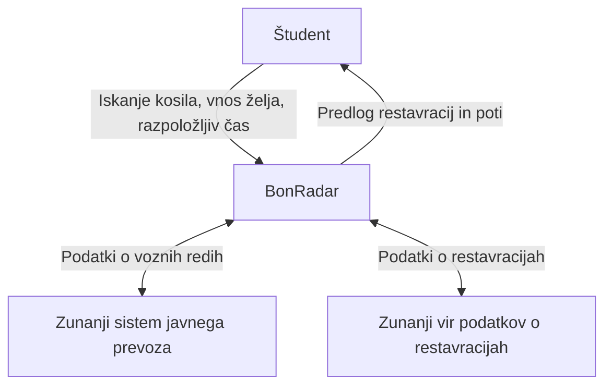

# C4 – Kontekst sistema BonRadar

## Namen sistema

BonRadar je aplikacija, namenjena študentom, ki želijo med predavanji najti primerno restavracijo s študentsko prehrano na bone. Aplikacija upošteva lokacijo študenta, razpoložljivi čas, želje glede prehrane in možnosti javnega prevoza.

## Udeleženci in zunanji sistemi

- **Študent:** Uporablja BonRadar za iskanje primernih restavracij in načrtovanje poti.
- **BonRadar:** Sistem, ki na podlagi razpoložljivih podatkov predlaga primerne restavracije in avtobusne povezave.
- **Zunanji sistem javnega prevoza:** Zagotavlja podatke o voznih redih in povezavah.
- **Zunanji vir podatkov o restavracijah:** Zagotavlja podatke o lokacijah restavracij, odpiralnem času in ponudbi študentske prehrane.

## Diagram konteksta

## Meje sistema

Zunanji sistemi za vozne rede in podatke o restavracijah niso del aplikacije, temveč predstavljajo zunanje vire podatkov.